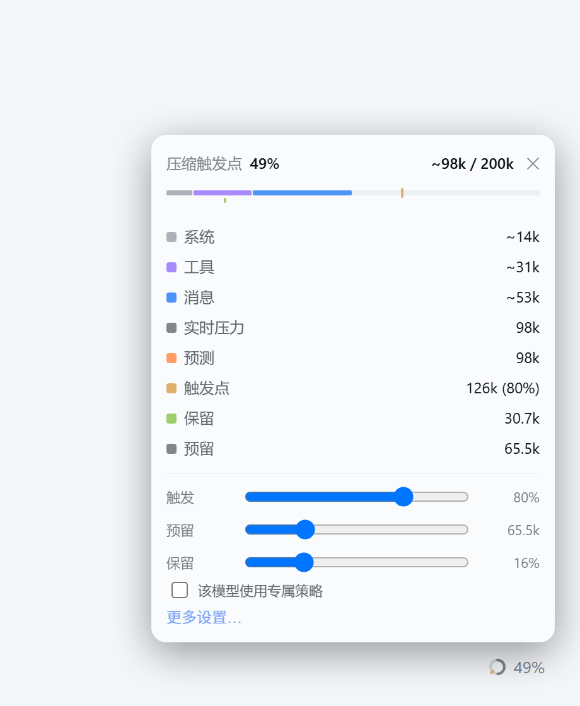
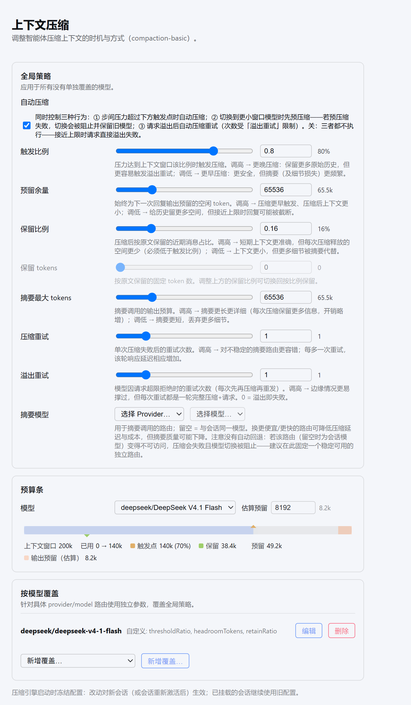

<div align="center">

# Compact Tool for DSH

**调整 DSH 的上下文压缩，在输入框里实时看到触发点。**

为 DeepSeek Harness 内置的 `compaction-basic` 提供设置页、按模型覆盖，以及输入框页脚的上下文用量环。

[](https://www.npmjs.com/package/@mileskent/dsh-compact-tool)
[](LICENSE)
[](#兼容性)

[快速开始](#快速开始) · [功能](#功能) · [配置写入](#配置写入) · [兼容性](#兼容性) · [架构](#架构) · [构建](#构建与本地安装)



</div>

---

## 快速开始

```console
dsh plugin --profile desktop add @mileskent/dsh-compact-tool
```

`desktop` 是示例 Profile，请替换为实际目标。**DSH NEXT Desktop 使用目标桌面壳提供的 DSH Desktop CLI**；不要用独立 npm 公共 CLI 管理保留的 `desktop` Profile。

1. **安装并启用**：按部署方式重载或重启，让 Host 与 Client 一起生效。插件管理页可见 `include:compact-tool`。
2. **打开「设置 → 上下文压缩」**：调整全局策略，或为某个模型单独覆盖。
3. **回到对话**：输入框页脚的环形图显示当前上下文用量，琥珀色刻度标出压缩触发点；点击环形图查看用量明细并调整当前模型的策略。

改动写入 Profile 的配置补丁，**新会话使用新配置**，已挂载的会话沿用原有配置。

## 功能预览

<picture>
  <source media="(prefers-color-scheme: dark)" srcset="https://raw.githubusercontent.com/KouzakiUmi/dsh-compact-tool/main/assets/screenshots/context-panel-dark.png">
  
</picture>

输入框页脚的环形用量图展开后的面板，随主题切换。

<picture>
  <source media="(prefers-color-scheme: dark)" srcset="https://raw.githubusercontent.com/KouzakiUmi/dsh-compact-tool/main/assets/screenshots/settings-dark.png">
  
</picture>

「设置 → 上下文压缩」：全局策略、预算条和按模型覆盖。

两张图由当前 `src/client` 的真实组件在浏览器里渲染，文字、边框和图表颜色取自 DSH 主题文件，圆角、阴影和字号用组件自带的回退值；数据为示例数据，不是运行中的 DSH 截图。

## 功能

### 设置页：设置 → 上下文压缩

- **全局策略**：`thresholdRatio`（触发比例）、`headroomTokens`（预留余量）、`retainRatio` / `retainTokens`（压缩后保留）、`maxTokens`（摘要输出上限）、`compactionRetries`、`maxOverflowRetries`、`auto`（自动压缩开关）和摘要模型路由。
- **预算条**：按所选模型的上下文窗口，画出预留余量、输出预留、触发点和保留点。预览读取正在编辑的值，拖动滑块时同步变化。
- **按模型覆盖**：从当前 provider / 模型目录下拉新增覆盖行；行内每个字段带「继承全局」开关，拖动继承字段会写入具体值并取消继承。
- **摘要路由检查**：显式配置的摘要 provider / 模型不在当前目录时，在对应位置给出提示，并提供一键改回会话模型。

### 输入框页脚：上下文用量环

页脚的环形图取代内置的上下文用量环：显示实时使用率，琥珀色刻度标出真实触发点，用量到达触发点后填充转为琥珀色。触发点按 `compaction-basic` 的算法计算：`min(窗口 × 触发比例, 窗口 − 输出预留 − 预留余量)`，所以触发点常常比触发比例低得多。例如 128k 窗口、默认预留余量 65536、按 8192 估算输出预留时，触发点约在窗口的 42%，而不是 80%。

点击环形图打开锚定面板：

- 实时压力：系统、工具、消息三段用量，叠加触发点和保留点。
- 三个快速滑块：触发、预留、保留，写入**当前模型**的覆盖行。
- 「该模型使用专属策略」开关，以及通往完整对话框的「更多设置…」。

### 模型选择器：⚙ 压缩设置…

模型菜单底部的 ⚙ 项打开同一个面板。

## 配置写入

- 写入通道是 `ctx.configEditor.edit`。使用 agent preset 的组合下，写入每个含 `compaction` 组的 preset 声明条目的 `config.plugins` 中的 `compaction-basic` 行；没有 preset 的组合直接写宿主的 `compaction-basic` 行。
- 默认 preset 先写入并作为界面的读取来源，其余 preset 在后台依次追平；某个次要 preset 写入失败只记录警告，不影响本次保存。
- `patchGlobal`：`null` 值删除该键；`modelPolicies` 整体替换。
- `setModelPolicy(provider, model, fields)`：按 `provider` + `model` 写入覆盖行；`null` 删除行内字段，行内字段全部删除后整行移除。
- `removeModelPolicy`：删除整行，恢复全局继承。
- 同一个策略的连续编辑合并为一次写入。Host 写入前核对全局和模型继承后的保留比例低于触发比例。
- 界面按 `compaction-basic` 的配置校验限制取值：保留比例必须低于触发比例；保留比例与保留 tokens 二选一；摘要 provider 与 model 成对写入，要么都为空、要么都非空；token 数和重试次数为整数，输入框里的小数在失焦或回车时取整。
- 对模型覆盖选择「改用会话模型」会保存一对空字符串；选择「继承全局」会删除这两个字段并恢复全局摘要路由。

## 兼容性

| 项目 | 内容 |
|---|---|
| 实测的 DSH 版本 | `0.2.2-rc.3`（插件挂载、保存链路与新会话生效） |
| 目标范围（`dsh.compatibility.runtime`） | `>=0.2.0-rc.2 <0.3.0-0` |
| peer 依赖 | `@deepseek-ai/cordis ^4.0.1`、`react ^18.2.0` |
| 宿主服务 | `llm`、`configEditor` |
| 客户端 | 运行时使用 `remote`、`slots`、`locale` 三个服务；`dsh.client.inject` 声明 `@deepseek-ai/` 下的 `dsh-api-session-controller`、`dsh-api-remotes`、`dsh-client-locale`、`dsh-client-ui-slots`、`dsh-client-ui-layout`、`dsh-client-ui-settings`、`dsh-client-ui-model-selection` |

插件挂载在 DSH 的 Web 客户端内，不修改 DSH Core。

## 架构

```
src/index.ts          Host: CompactToolController extends TypertRemoteService
                      namespace `compactTool`，service key `compactTool`
                      @Remote: describe / catalog / modelInfo / effectiveFor
                              / patchGlobal / setModelPolicy / removeModelPolicy
src/shared.ts         Host↔Client 共享的 wire 类型、默认值与 mergePolicy
                      （字段名逐字节镜像 dsh-compaction-basic 的 Config schema）
src/targets.ts        定位 preset 内的 compaction-basic 配置行
src/client/index.tsx  Client: remote $mount + locale + 槽位注册
src/client/*.tsx      SettingsPage / DockEntry / PolicyDialog / GearOption / BudgetBar /
                      PolicyEditor / controls
build.mjs             esbuild：lib/index.js (ESM, external @deepseek-ai/*)
                              lib/client.js (ModuleLoader CJS factory)
```

`@Remote` 方法由网关 SRC 描述符推导（参数 → src-json，末尾 `signal` → cancellation）。客户端用等价的手写 InvocationDescriptor，调用返回 `RemoteResult`（`{ok,value}` 或 `{ok:false,error}`）。

## 构建与本地安装

```console
npm ci
npm run build      # → lib/index.js + lib/client.js（含 banner 校验）
npm run watch
```

克隆仓库并完成构建后，在仓库目录运行以下 PowerShell 命令。`desktop` 可以替换为你的 DSH profile 名。

```powershell
$pluginPath = (Get-Location).Path
dsh plugin --profile desktop add "link:$pluginPath"
```

## License

[MIT](LICENSE)
